# Gardenly – user guide

Gardenly is a planting planner for phones and computers. You draw the garden from above, to the centimetre, and the app:

- checks the rules of the area (height, toxic plants, walnut zone, spacing and so on);
- works out how many plants you need and what they cost;
- shows the garden in every season;
- builds a planting schedule.

All data stays on your own device, there is no sign-up, and after the first visit it also works offline.

**Contents**

1. [First start](#1-first-start)
2. [The screen](#2-the-screen)
3. [Areas](#3-areas)
4. [Fixed elements: lawn, paving, wall, tree…](#4-fixed-elements-lawn-paving-wall-tree)
5. [Placing plants](#5-placing-plants)
6. [Selecting, editing, replacing](#6-selecting-editing-replacing)
7. [Plant info and photo](#7-plant-info-and-photo)
8. [Warnings](#8-warnings)
9. [Plant database and filters](#9-plant-database-and-filters)
10. [Variants](#10-variants)
11. [Idea generator](#11-idea-generator)
12. [Season view](#12-season-view)
13. [Plant list, ordering, cost](#13-plant-list-ordering-cost)
14. [Planting schedule and care](#14-planting-schedule-and-care)
15. [Saving, sharing, printing, images](#15-saving-sharing-printing-images)
16. [Visualisation with ChatGPT](#16-visualisation-with-chatgpt)
17. [Installing on the phone, offline use](#17-installing-on-the-phone-offline-use)
18. [Tips and FAQ](#18-tips-and-faq)

---

## 1. First start

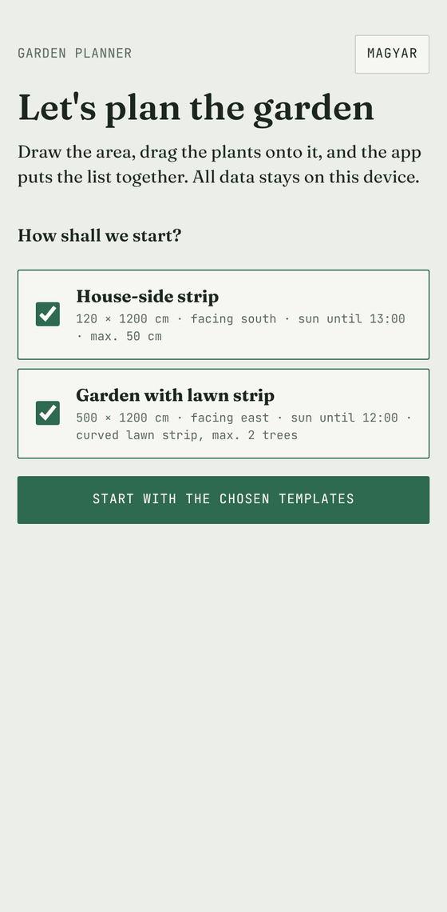

1. Open the app.
2. On the start screen, choose which ready-made templates to start with:
   - **House-side strip**: a 120 × 1200 cm gravel strip between the house wall and the pavement, for plants up to 50 cm;
   - **Garden with lawn strip**: 500 × 1200 cm, a curved lawn strip in the middle, beds on both sides, a walnut tree next door.
3. Tap **Start**.
4. Or choose **+ Create my own area** below: the new-area form opens at once (name, size, facing, sun; a rectangle or a free shape drawn on the plan, see [chapter 3](#3-areas)). The templates can be added later too.

At the top right of the start screen you can switch to Hungarian and to dark mode; later with the **EN / HU** and **☾ / ☀** buttons in the top bar. By default the app follows the browser language.

The first time, a short three-step introduction shows the most important buttons. You can see it again with **⋯ → Show the intro again**.

 

## 2. The screen

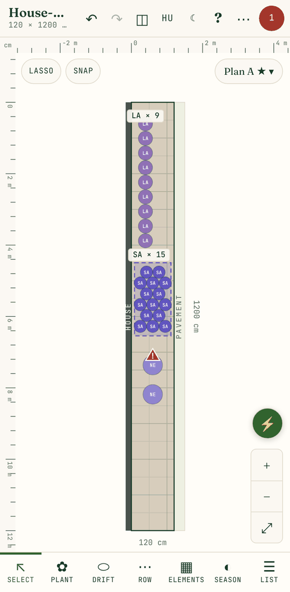

**Top bar**

- **Area name ▾**: switch between areas and create new ones here. Below it: the size of the area, the number of plants, the facing and the sun.
- **↶ / ↷**: undo and redo (up to 100 steps). On a computer **Ctrl+Z** and **Ctrl+Y** work too.
- **EN / HU**: switches to English or Hungarian with one tap.
- **☾ / ☀**: dark or light mode with one tap.
- **◫ View**: layers, plant size (mature or at planting), photos, snap, **appearance** (automatic, light, dark), **language**; the plant database, fixed elements, idea generator and schedule open from here as well.
- **? Help**: this guide, inside the app, offline too. It opens at the chapter for the tool in use.
- **⋯ Project**: save, load, share, images, visualisation, print.
- **Round number**: the number of warnings. Green when all is fine, red when there is an error.

**Quick actions (⚡)**: on the right of the plan, above the zoom buttons. A searchable list of every feature (e.g. “replace”, “image”, “backup”), and the **steps of a first plan** checklist: area, fixed elements, plants, fixing errors, a variant, the list, a backup. Done steps tick themselves. On a computer **Ctrl+K** opens it too.

**The plan**

- **Zoom**: pinch with two fingers; on a computer use the mouse wheel or the **+ / −** buttons at the bottom right.
- **Move**: drag with one finger on an empty spot, or with two fingers.
- **Fit**: double-tap or the **⤢** button shows the whole area.
- **Rulers**: along the edges, in metres.
- **Variant button**: top right (e.g. “Plan A ★ ▾”), opens the variants.

**Windows**: settings open in windows. Close one with the **×** in the header, by pulling the header down, or by tapping the dark background. The **?** in the header opens the help chapter for that window.

**Bottom toolbar**

| Tool | What it is for |
|---|---|
| **Select** | select, move and edit elements |
| **Plant** | place single plants |
| **Drift** | fill an area with one species |
| **Row** | plant along a straight line or a curve |
| **Elements** | draw lawn, paving, wall, fence, tap, tree and so on |
| **Season** | the garden’s colours month by month |
| **List** | plant list, ordering, cost, schedule |

 

## 3. Areas

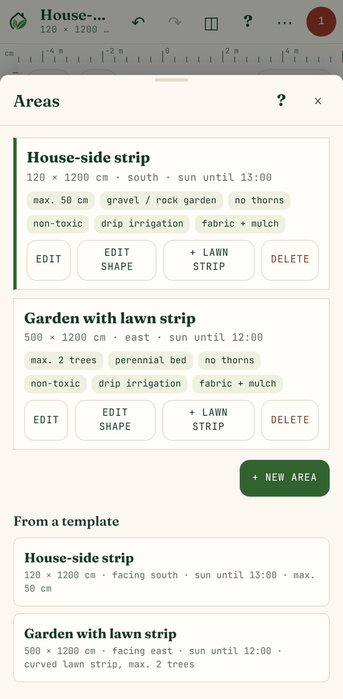

A project can have several areas (e.g. front garden, side strip, back garden). Tap the **area name** to open the list:

- **Tap an area’s name** to switch to it.
- **Edit**: name, size, facing, sun, soil and limits.
- **Edit shape**: drag the corners of the area on the plan.
- **+ Lawn strip**: draw a lawn on this area (see [chapter 4](#4-fixed-elements-lawn-paving-wall-tree)).
- **Delete**: undo brings it back.
- **+ New area** or **From a template**: add an area.

**New area details**

- **Name**
- **Shape**:
  - **rectangle**: enter the width and length in cm;
  - **free shape**: you draw it on the plan. Tap the corners one after another, then tap the first point again or press **Done**. While drawing, side lengths show in cm; **Back** removes the last point.
- **Facing and sun**: give the sun as text, e.g. “until 13:00”, “until noon”, “all day”. From this the app works out whether the spot is sunny, part shade or shade; you can override it with *Light for the rules*.
- **Area type**: perennial bed, gravel/rock garden, shade bed, edging, patio with pots. It affects the mulch advice and the idea generator.
- **Soil**: sandy, loam, clay, chalky, acidic, poor. If set, the app tells you when a plant prefers another soil.
- **Limits**:
  - maximum height;
  - *No thorns*;
  - *Non-toxic only* (for children and pets);
  - maximum number of trees;
  - a limit per species (e.g. “LA: 12”);
  - drip irrigation and bed cover (these affect the care advice).

**Changing a shape**: *Edit shape*. Drag the corners. The dot in the middle of a side adds a corner; **Delete corner** removes the selected one.

 

## 4. Fixed elements: lawn, paving, wall, tree…

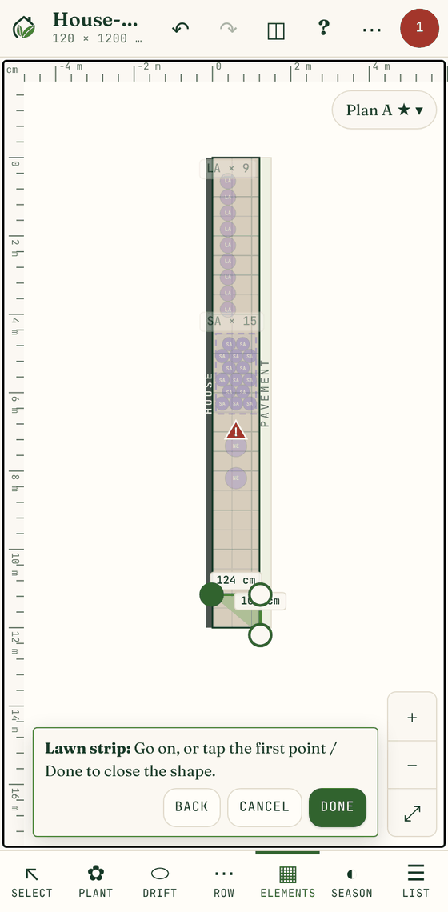

Fixed elements are not plants but part of the plan: the rules and the idea generator take them into account. The **Elements** button in the bottom toolbar opens a row of elements under the plan.

| Element | How you draw it |
|---|---|
| **Lawn strip** | Tap its corners, then *Done*. No plants go there: you get a warning if one does. |
| **Paving, Gravel bed, Pond, Shed, Raised bed** | Drag out the rectangle (the pond becomes an oval); a tap places one of the default size. |
| **Wall, Fence, Path** | Drag along the line; it follows the longer direction. |
| **Window, Tap, Manhole, Well, Compost bin, Rain barrel, Bench, Tree, Walnut, Other** | Tap the plan where it should go. |

**Gravel beds** and **raised beds** can be planted. A plant on paving, a path, pond, well, shed, compost bin, rain barrel, bench, tap or manhole gets a warning, and the idea generator and zone fill leave them free.

**Selecting and changing elements**

- Tap any element to select it (with the **Select** tool, or with the **Elements** tool when no element is picked). Its name, **Details** and **Delete** appear at the bottom.
- Small elements (tap, manhole, well, bench, tree…) can be dragged straight away. Large ones (wall, fence, paving, lawn, pond, shed, path…) **only move once selected**, so scrolling the plan does not shift them by accident.
- Drag the **handle** at the selected element’s corner to resize it (for a tree, its crown radius).
- **Details** sets the type, label, position and size to the centimetre.
- Trees are selected by their trunk, so elements under the crown stay reachable.

**After placing**

- The new element stays selected: drag it, resize it, or edit it with **Details**.
- A lawn’s shape can be changed later: *List → lawn strip → Edit the shape on the plan*.
- **List** shows all elements; for a lawn also its area in m², handy for seed or turf.

**Walnut and the juglone zone**

Walnut roots release juglone, which harms many plants. The zone radius is set in the *Fixed elements* list (15 m by default). Inside the zone the app flags species whose juglone tolerance is undocumented or sensitive.

**Background image**

In the *Fixed elements* list you can also put a **background image** (photo or drawing) under the plan. Set the scale by marking two known points. The opacity can be changed, and it can be hidden under *View → Layers*.

 

## 5. Placing plants

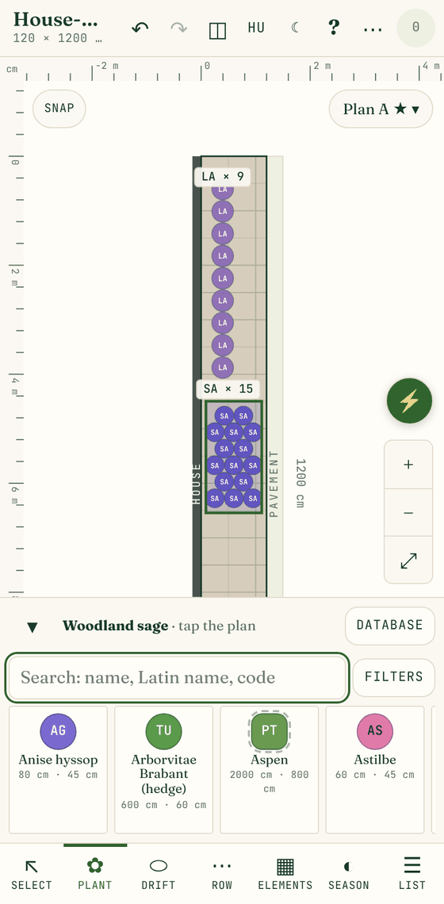

With the **Plant**, **Drift** and **Row** tools the **plant palette** appears at the bottom:

- **Search** by name, Latin name or code (e.g. “lavender”, “Salvia”, “LA”);
- **Filters** narrows by toxicity, height, spread, light and soil (see [chapter 9](#9-plant-database-and-filters));
- hovering with the mouse, or pressing and holding on a phone, shows the plant’s **info card**;
- the **▾** button collapses the palette.

Every plant has a two-letter **code** and its own colour (e.g. LA = lavender). That is how you recognise it on the plan and in the lists.

**Single plant** (*Plant* tool): tap a plant in the palette, then the plan. You can also drag it up from the palette onto the plan.

**Drift** (*Drift* tool): pick a plant, then draw around the area with your finger. The app fills the drift at the right spacing and shows the count. At the top choose a **staggered** (more natural) or **grid** layout.

**Row** (*Row* tool):

- **Straight**: drag a line, or tap both ends.
- **Curve**: trace the line with your finger.

Plants are placed at even spacing along the line; the count is automatic.

**Snap**: aligns to a 10 cm grid. Its button is at the top, and it can also be switched in the *View* menu.

 

## 6. Selecting, editing, replacing

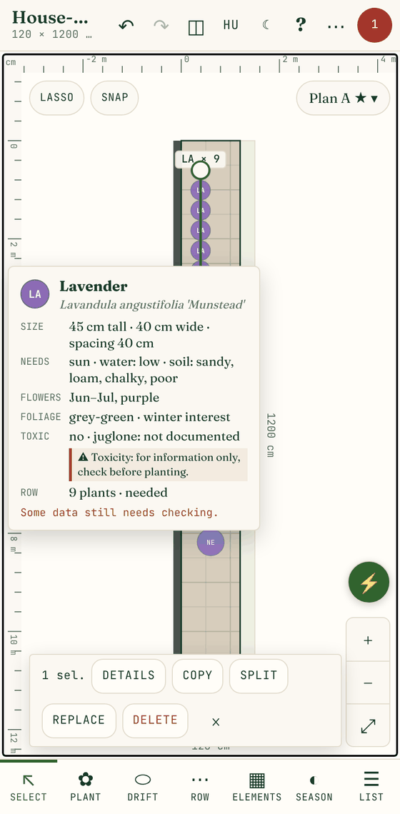

With the **Select** tool:

- **Tap** a plant or drift to select it.
- **Shift/Ctrl + click**: select several on a computer.
- **Lasso**: switch it on and draw around the elements to select.
- **Drag**: moves the selection.
- **Corners of a drift or row**: drag them to reshape it; the count updates as you go.
- **Spread**: a selected single plant shows a dot on its right edge. Drag it to make the crown bigger or smaller (e.g. for an older, larger specimen); the plan shows the diameter while you drag. The size can also be typed in cm under *Details*, and **Back to species size** resets it. It only affects that one plant, not the species; the spacing rule uses the new size.

The bar under the selection:

- **Details**: species, status (*needed, ordered, have it, planted*), note. For drifts and rows the **spacing** and the desired **count** can be set here too; from a count the app works out the spacing.
- **Copy**: a slightly shifted copy of the selection.
- **Split** (drifts and rows): splits the drift or row into single plants. They stay in place but can then be moved, deleted or replaced one by one. By default every drift and row stays in one piece; split only when you want to handle plants individually.
- **Replace**: replace all of this species with another (see below).
- **Delete**
- **×**: clear the selection.

### Replacing a species everywhere

If you don’t like a species (e.g. the one chosen for the hedge), replace it with another in one step. Available from the **Replace** button of the selection bar, from *Details*, or from the variants with **⇄ Replace plants**.

1. **Replace this**: the species to replace (pre-selected when started from a selection).
2. **Replace with (one or more plants)**:
   - tap one or more species; tap again to remove;
   - **similar types** come first (a hedge for a hedge, a shrub for a shrub), similar heights first among them;
   - a ⚠ shows why a species does not suit the area.
3. **With several plants** the app mixes them at random:
   - **share**: set for each chosen species (e.g. 2 : 1). Counts follow it exactly, only the order is random;
   - **per plant**: drifts and rows are split into single plants, and each spot gets one of the species at random. For example, 100 cherry laurels become 50 red-tip photinias and 50 forsythias, mixed. Plants keep their old spots; if the new ones are bigger, warnings show where it gets too dense;
   - **per item**: a whole drift or row gets one species.
4. **Where**: only in the edited variant, in every variant of the area, or in the whole project.
5. **Spacing**: by default the remaining drifts and rows take the new plant’s spacing, and the count is recalculated.
6. The preview shows the result; **Replace** does it. Undo brings everything back.

 

## 7. Plant info and photo

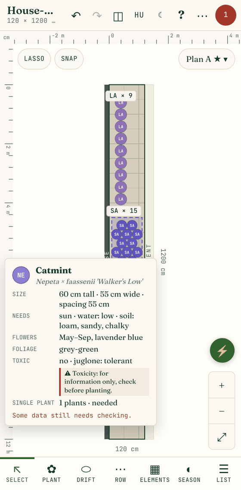

Hover over a plant on the plan or in the palette, or hold your finger on it for half a second on a phone. The **info card** appears:

- photo;
- common and Latin name;
- height, spread, spacing;
- light, water and soil needs;
- flowering time and colour, foliage colour, winter interest;
- toxicity, thorns, juglone tolerance;
- on the plan also how many plants are in that drift or row, and their status.

**Photos**

- **Source**: the app downloads them from Wikipedia/Wikimedia Commons by the Latin name. The author and the licence are shown under the image.
- **Offline**: after the first load the photo is stored on the device and shows without internet.
- **Species, not cultivar**: Wikipedia usually has a photo of the species rather than the exact cultivar.
- **Own photo**: for a different picture, upload your own or give an image link on the plant’s page.
- **Turning it off**: *View → Plant photos from Wikipedia*.

**“To check” data**

If the card shows this label, some of the plant’s data (e.g. toxicity, juglone tolerance, price) comes from an uncertain source. Check it before buying.

 

## 8. Warnings

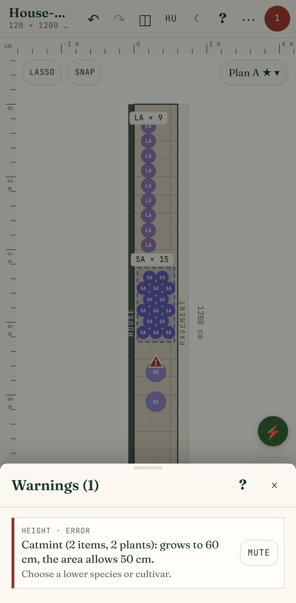

The app checks the plan all the time and marks problems on the plan with ⚠. It watches:

- **height**: the plant is taller than the area allows;
- **thorns, toxic**: if the area asks for no thorns or non-toxic plants;
- **juglone**: a sensitive or undocumented species in the walnut zone;
- **spacing**: a drift or row that is too dense, or plants overlapping;
- **outside the area**: the plant is outside the area;
- **lawn**: a plant on the lawn strip;
- **tap, manhole, paving**: the plant covers it; **window**: a tall plant in front of a window;
- **species limit, number of trees**;
- **light, water and soil needs**: unsuitable for the spot, or plants with different water needs side by side.

Tap the round number in the top bar to open the **list**. Tapping a warning jumps to it and selects the plant. If something is a deliberate exception, **Mute** it; muted warnings stay visible at the bottom of the list.

 

## 9. Plant database and filters

The database has 146 species: perennials, grasses, ground covers, shrubs, hedge plants, spreading evergreens and trees. Open it with *View → Plant database*, or the **Database** button in the palette.

- **Edit**: tap a plant to change any of its data: name, code, size, spacing, needs, flowering, colours, price, pot size, photo, notes. Tap the “to check ✓” label to mark that you have checked it. Each plant has an English and a Hungarian name and texts; the other language is in the box at the bottom.
- **+ New plant**: add your own plant; the code is suggested from the name.
- **Data check**: on a plant’s form you can give the **data source** and the **last checked** date; *All checked* clears every “to check” mark. **List of values to check (CSV)** collects the values still to check, per species and field, with an empty “correct value” column for an expert review.
- **Toxicity**: for information only, not medical or veterinary advice; check it in a reliable source before planting near children or pets. The filter, the info card and the area’s “Non-toxic only” limit say so too.
- **Import and export**: JSON and CSV. Texts starting with `=`, `+`, `-` or `@` get a leading apostrophe so Excel does not run them as formulas; it is removed again on import. The CSV can be edited in Excel or Google Sheets and loaded back.

**Filters** (shared by the palette and the database):

- **toxic**: non-toxic / toxic / unknown;
- **height** and **spread**: from cm to cm;
- **light**: sunny, part shade, shade;
- **soil**;
- **thorns**, **juglone tolerance**, **flower colour**.

## 10. Variants

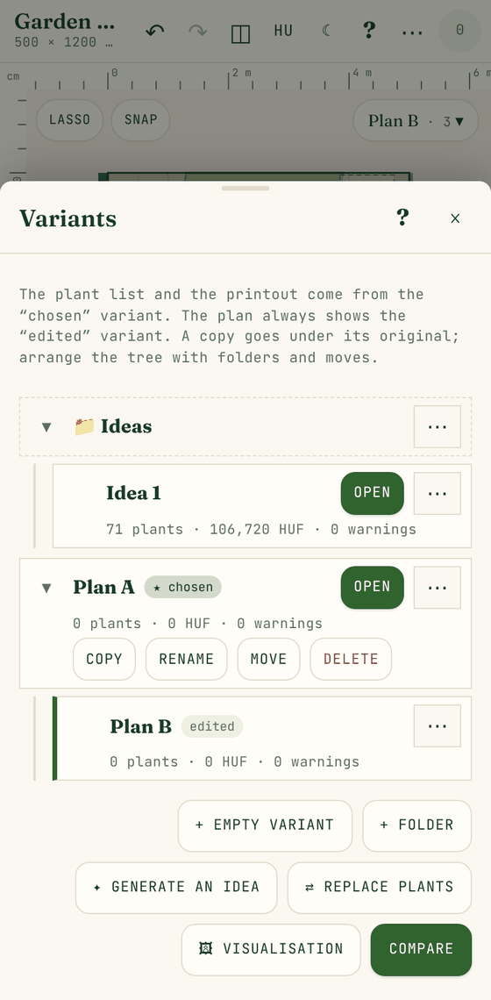

An area can have several plans (Plan A, Plan B, ideas) that you can compare. The **variant button** at the top right of the plan opens the variant **tree**.

**Two key terms**

- the **edited** variant: the one you see and change on the plan;
- the **★ chosen** variant: the plant list, schedule and printout come from it.

**Working with the tree**

- **Open**: edit that variant.
- **⋯** at the end of a row: *Make it the chosen one*, *Copy*, *Rename*, *Move*, *Delete*.
- **Copy**: the copy goes under its original.
- **+ Folder**: group variants. **Move** puts an item under any folder or variant, or at the top level.
- **▾ / ▸**: collapse branches; when collapsed it shows how many variants are inside.
- Deleting a folder or variant moves what is below it up one level.
- **Compare**: two variants side by side with the difference in plants, cost and warnings.

 

## 11. Idea generator

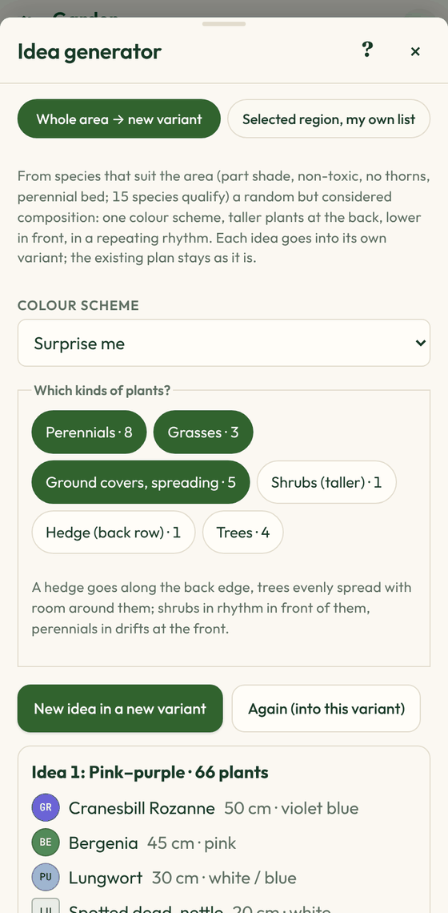

Not sure where to begin? Ask for an idea. Open it from the variants with **✦ Generate an idea**, or *View → Idea generator*. There are two modes at the top:

- **Whole area → new variant**: the app picks species that suit the area (see below);
- **Selected region, my own list**: you give the plants and they go into a region you mark on the plan (see [Filling a selected region from your own list](#filling-a-selected-region-from-your-own-list)).

### Whole area → new variant

1. **Colour scheme**: *Surprise me*, or purple–silver, warm yellow–burgundy, white–blue–green, pink–purple.
2. **Which kinds of plants** (see the table), and the **Variety and density** part:
   - **Mixed planting**: species alternate plant by plant instead of drifts, and no two of the same plant go side by side;
   - **Extra distance between plants (cm)**: added to the recommended spacing, so plants go further apart (0 = the recommended spacing).

   Kinds:

   | Kind | Where it goes |
   |---|---|
   | Perennials, Grasses, Ground covers | in repeated drifts, lower ones in front |
   | Shrubs | one by one, in rhythm |
   | Hedge | in a row along the back edge (wall or fence side) |
   | Trees | evenly spread, with free space around them |

   The number next to each kind shows how many species qualify for this area. Kinds with none can’t be chosen (e.g. a hedge in a strip limited to 50 cm).
3. **Generate an idea**: the composition goes into a new variant (*Ideas* folder); the existing plan does not change.
4. **Again**: draws a new one into the same variant. **New idea in a new variant**: makes another one next to the old one.

**What the generator takes care of**

- only species that suit the area’s light, limits and soil;
- it avoids the lawn and paving;
- it chooses juglone-tolerant species in the walnut zone;
- flowering from spring to autumn and something for winter.

The rule engine checks the result straight away. After that you can edit the variant like any other.

 

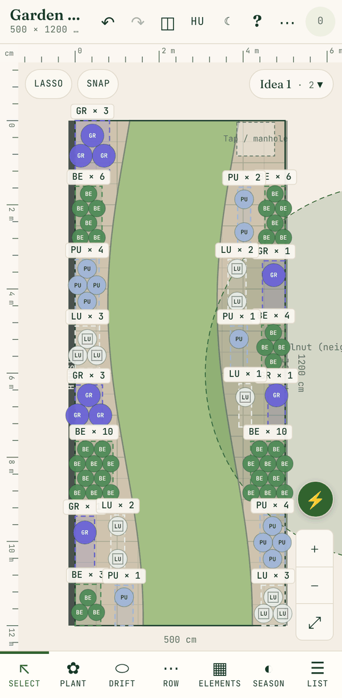

### Filling a selected region from your own list

1. In the idea generator choose the **Selected region, my own list** tab.
2. **From these plants**: search and tap species (up to 12). Each can get a **share**.
3. **Layout**:
   - **mixed**: species mix plant by plant at random, like a natural bed or meadow;
   - **in small groups**: 5–9 plants of one species together, groups alternating at random.
4. **Density**: *denser*, *by spacing* or *looser*.
   - **No two of the same plant side by side** (mixed layout only): if the species drawn is already next door, another one is used.
   - **Extra distance between plants (cm)**: for sparser planting.
5. **Remove the plants in the region first**: if ticked, the new filling replaces the old plants; otherwise the app avoids what is already planted.
6. **Mark the region on the plan**: tap its corners, then **Done**. The app fills it right away.

Plants are placed keeping their spacing; they avoid the lawn, paving, taps and manholes, and stay inside the area. The result goes into the **edited variant**, and the count per species is shown.

- **Again, same place**: refills the same region with a new random layout; the previous filling disappears.
- **Undo**: every filling can be undone in one step.
- **Warnings**: your own list is not filtered by the area’s conditions, so if a species does not suit the spot (e.g. too tall, not for sun), the warnings say so.

## 12. Season view

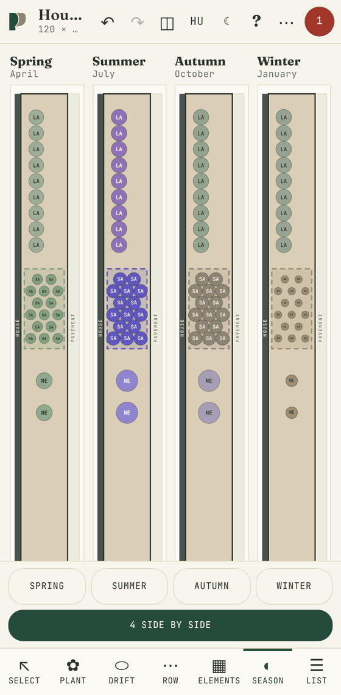

With the **Season** tool the plan shows the plants’ real colours:

- **Spring, Summer, Autumn, Winter** buttons or the month slider: see what flowers, what the foliage looks like, what stays in winter;
- **4 side by side**: all four seasons at once, to compare.

An image (PNG/SVG) made from the season view uses that month’s colours.

 

## 13. Plant list, ordering, cost

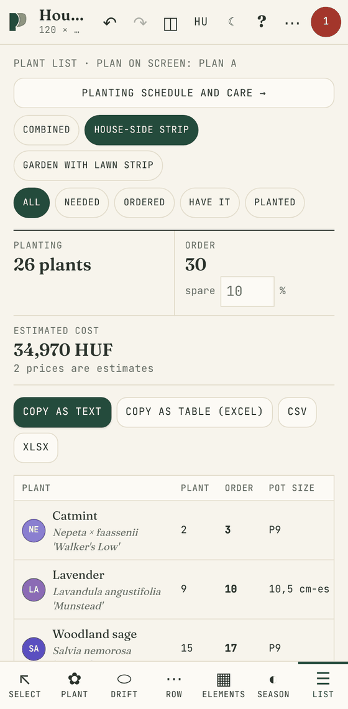

By default the **List** tool totals **the plan currently on screen** (the edited variant of the current area; the header shows its name). **★ Chosen variants** switches to the list made from the chosen variants – the printout uses those too.

- **Planting**: how many plants go in the ground.
- **Order**: how many to order, with a **spare**. The spare % can be set; trees get none.
- **Estimated cost**: prices marked “est.” are estimates, those marked “shop” come from real offers. Prices are in HUF.
- **Filter**: *Plan on screen* or *★ Chosen variants*; *Combined* or per area; by status (*needed, ordered, have it, planted*).
- **Status**: can be set for a whole species at once in the table.
- **Copy as text**: for messages and e-mail.
- **Copy as table (Excel)**: pastes into the right columns.
- **CSV, XLSX**: download a file; **Share**: the share menu on phones.

 

## 14. Planting schedule and care

Open it with **Planting schedule and care →** at the top of the *List* (or *View → Schedule and care*).

- **Schedule**: give the start and end of planting. The app splits the work into days based on the area:
  - soil preparation;
  - drip line and fabric, if ticked for the area;
  - trees first, then perennials by species;
  - mulching, watering in;
  - a spare day for rain or late delivery.

  Tasks can be ticked off; **Copy the schedule as text** gives a text ready to share.
- **Care calendar** for the climate of Győr: month by month, the tasks for the species in the plan (e.g. cutting back lavender, combing out grasses, watering young trees in drought).
- **Mulch advice**: light 4–8 mm gravel around drought-tolerant plants, bark elsewhere, with the recommended depth.

## 15. Saving, sharing, printing, images

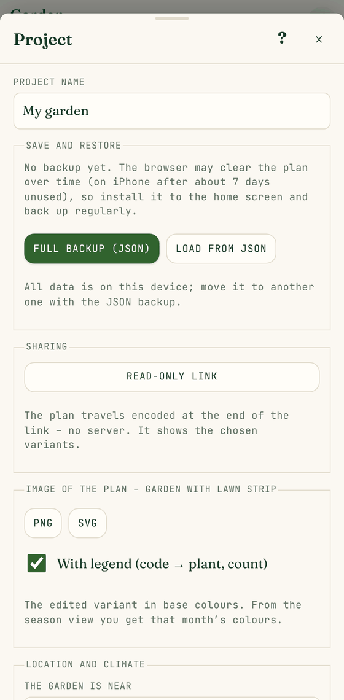

**Automatic saving**: your work is saved on the device after every change; there is no “Save” button.

The **⋯** button in the top bar opens the **Project** menu:

- **Project name**
- **Full backup (JSON)**: the whole project in one file. Use it to move to another device; it is also your backup. On a computer (Chrome, Edge) you can pick the folder too. Above it you see when you last backed up and whether the browser keeps the plan permanently. **Load from JSON** restores it (it replaces the current plan); the file is checked first, and a broken or oversized backup is refused.
- **Backup reminder**: once there is something to lose and you have not backed up for a week (or ever), a bar below the top bar says so. **Save to file** or **Later** (quiet for 3 days).
- **Location and climate**: which town the garden is near (or your own frost dates). The schedule’s frost notes and the visualisation brief use it.
- **About**: version, author, **Legal information and privacy** (terms of use, privacy notice, data sources) and the **open-source licences**.
- **Read-only link**: the plan travels encoded at the end of the link, no server. Whoever opens it sees the plan and the list but can’t change them.
- **Image of the plan**: **PNG** or **SVG**, optionally **with a legend** (code → plant name, Latin name, count).
- **Visualisation with ChatGPT**: see the next chapter.
- **Print / save as PDF**: A4, portrait or landscape. One page per area: plan view, four seasons, plant list, warnings, with a summary at the end. Save as PDF from the browser’s print dialog (“Save as PDF”).
- **Show the intro again**

 

## 16. Visualisation with ChatGPT

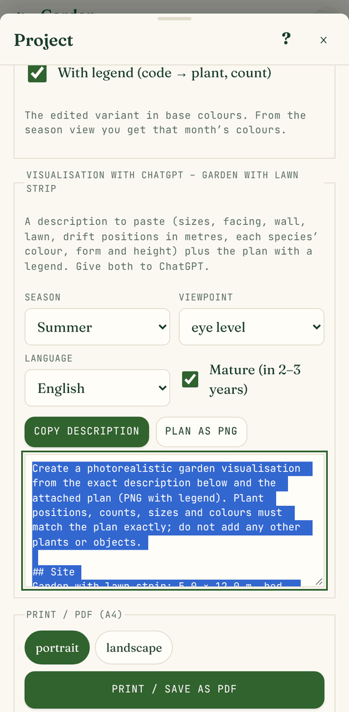

The app writes a detailed description and a plan from which an image AI (e.g. ChatGPT) can draw a realistic visualisation.

**Opening it**: the **🖼 Visualisation** button in the **Variants** window, or **⋯ Project → Open visualisation**. It is made for the variant being edited on the plan.

1. **Viewpoint on the plan**: place the camera with **📷 Viewpoint on the plan**. Press where you stand (e.g. on the terrace) and drag towards where you look. The orange view cone shows what will be in the picture. It can be moved or removed later. On the plan the camera only shows while you place it and while the Visualisation window is open; otherwise turn it on with *View → Layers → Visualisation viewpoint (camera)*.
2. **Image**: from the camera (eye level), bird’s-eye, both (two images), or a generic view from the bottom edge.
3. **Style and mood**: photorealistic, watercolour or design sketch; season; time of day (morning, afternoon, sunset); weather (sunny, overcast); language of the brief; mature or freshly planted.
4. **Send to ChatGPT**:
   - **on a phone** the share sheet opens: pick ChatGPT and the description arrives with the plan (the description also goes to the clipboard, in case the app only takes the picture);
   - **on a computer** the description goes to the clipboard, the plan downloads and chatgpt.com opens in a new tab: paste the text and drop the image next to it.
5. **Copy description** and **Plan as PNG** do the two steps separately too.

The description has the sizes, the elements, every drift’s position in metres, each species’ colour, form and height in that season, and what the camera sees as foreground, middle ground and background (left, centre, right). The PNG shows the camera and its view cone too.

**Keeping the finished image**: save the image ChatGPT made, then use **Upload image** under **Finished images** to put it next to the variant. Images stay on the device (they are in the backup, not in a shared link). In the **Variants** window the 🖼 number shows how many images a variant has, and **Compare** shows the images side by side.

The description asks the AI not to add any other plants or objects. The result is still an illustration; the exact plan is the drawing and the list.

 

## 17. Installing on the phone, offline use

The app can be installed on the home screen like a mobile app:

- **Android (Chrome)**: ⋮ menu → *Install app* or *Add to Home screen*.
- **iPhone (Safari)**: Share button → *Add to Home Screen*.
- **Computer (Chrome, Edge)**: the install icon at the end of the address bar.

After the first visit it **works offline**, and your work is saved on the device. Internet is only needed for the first download of photos.

**Updates:** the app looks for a new version on start, when it comes back to the foreground and every half hour, and reloads itself when there is one. **⋯ Project → About** shows which version runs (version and build time). If the phone still shows the old one, close the app (or the browser tab) completely and open it again.

**If something breaks:** if the saved plan is damaged or the app hits an error, the “Something went wrong” screen appears. First **download the plan (JSON)**, then try **Reload**, and only if needed **Start over** (this removes the broken plan from the device).

**Important:** the data is stored in the browser. If you clear the browser data or switch device, the plan does not follow by itself. Make a **Full backup (JSON)** now and then.

## 18. Tips and FAQ

**Which tool plants many plants fast?**
Drifts and rows: one gesture, and the count is automatic. Single plants are best for specimens, trees and accents.

**How do I plan a brand-new garden?**
1. Create an area (rectangle or drawn shape) and set the facing, sun, soil and limits.
2. With the **Elements** tool draw the lawn, paving, wall, fence and existing trees.
3. Ask the **idea generator** for an idea or two, or plant by hand.
4. Fix or mute the warnings.
5. Mark the best variant as **★ chosen**.
6. Check the **List** and the **Schedule**, and print a PDF.

**I don’t like a species, but it is already in many places. What now?**
Use **Replace** ([chapter 6](#replacing-a-species-everywhere)); it replaces every one of them in one step, even with a random mix of several species.

**I want to plant part of a bed quickly with a few favourites.**
Idea generator → **Selected region, my own list**: pick the plants, mark the region, and the app plants it at random ([chapter 11](#filling-a-selected-region-from-your-own-list)).

**Why does it flag a plant I think is fine there?**
The rules work from the limits you set and the plant’s data. If the plant data is wrong, fix it in the database; if it is a deliberate exception, use **Mute**.

**I can’t see a window’s × on my phone.**
Windows fit the visible part of the screen, so Safari’s address bar doesn’t cover the header. If it still happens, pull the window’s header down or tap the dark background above it.

**Can I switch to Hungarian?**
Yes: *View → Language → Magyar*. The interface, warnings, lists and exports switch language; plants have names in both. Your plans don’t change, and you can switch back any time.

**I made a mistake.**
**↶ Undo**, up to 100 steps. Deleted areas, variants and replacements come back too.

**How can someone else look at my plan?**
**⋯ → Read-only link**. If they should edit it too, send the **Full backup (JSON)** file; they open it with *Load from JSON*.

**Is the plant data accurate?**
The starting list is built from general horticultural data. Uncertain data (especially toxicity, juglone tolerance and estimated prices) is marked **to check**; look it up before buying and correct it in the database.

---

*Gardenly · Created by Kiss-Mihály István · © 2026 Kiss-Mihály István. All rights reserved.*
