# Kerttervező – felhasználói útmutató

A Kerttervező egy telefonon és számítógépen is használható ültetéstervező. Felülnézetben, centiméterre pontosan rajzolod meg a kertet. Az alkalmazás közben:

- figyeli a terület szabályait (magasság, mérgező növény, diófa-zóna, tőtáv stb.);
- kiszámolja, hány tő kell és mennyibe kerül;
- megmutatja a kertet minden évszakban;
- elkészíti az ültetési menetrendet.

Minden adat a saját készülékeden marad, nincs regisztráció, és első megnyitás után internet nélkül is működik.

**Tartalom**

1. [Első indítás](#1-első-indítás)
2. [A képernyő részei](#2-a-képernyő-részei)
3. [Területek](#3-területek)
4. [Rögzített elemek: gyep, burkolat, fal, fa…](#4-rögzített-elemek-gyep-burkolat-fal-fa)
5. [Növények elhelyezése](#5-növények-elhelyezése)
6. [Kijelölés, szerkesztés, csere](#6-kijelölés-szerkesztés-csere)
7. [Növényinformáció és fotó](#7-növényinformáció-és-fotó)
8. [Figyelmeztetések](#8-figyelmeztetések)
9. [Növényadatbázis és szűrők](#9-növényadatbázis-és-szűrők)
10. [Változatok](#10-változatok)
11. [Ötletgenerátor](#11-ötletgenerátor)
12. [Évszaknézet](#12-évszaknézet)
13. [Növénylista, rendelés, költség](#13-növénylista-rendelés-költség)
14. [Ültetési menetrend és gondozás](#14-ültetési-menetrend-és-gondozás)
15. [Mentés, megosztás, nyomtatás, képek](#15-mentés-megosztás-nyomtatás-képek)
16. [Látványterv ChatGPT-vel](#16-látványterv-chatgpt-vel)
17. [Telepítés a telefonra, offline használat](#17-telepítés-a-telefonra-offline-használat)
18. [Tippek és gyakori kérdések](#18-tippek-és-gyakori-kérdések)

---

## 1. Első indítás

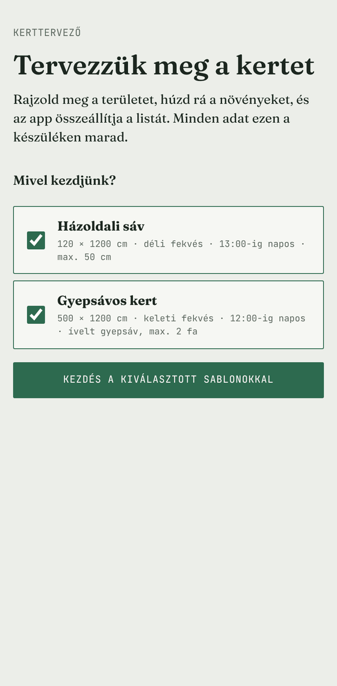

1. Nyisd meg az alkalmazást.
2. A kezdőképernyőn válaszd ki, melyik kész sablonnal indulsz:
   - **Házoldali sáv**: 120 × 1200 cm-es kavicsos sáv a ház fala és a járda között, legfeljebb 50 cm magas növényekkel;
   - **Gyepsávos kert**: 500 × 1200 cm, ívelt gyepsáv a közepén, ágyások két oldalt, diófával a szomszédban.
3. Nyomd meg a **Kezdés** gombot. Ha egy sablont sem választasz, üres projekttel indulsz, és a területet magad hozod létre (lásd [3. fejezet](#3-területek)).

Első alkalommal egy rövid, háromlépéses bevezető mutatja meg a legfontosabb gombokat. Később a **⋯ → Bevezető újra** gombbal újra megnézheted.

 

## 2. A képernyő részei

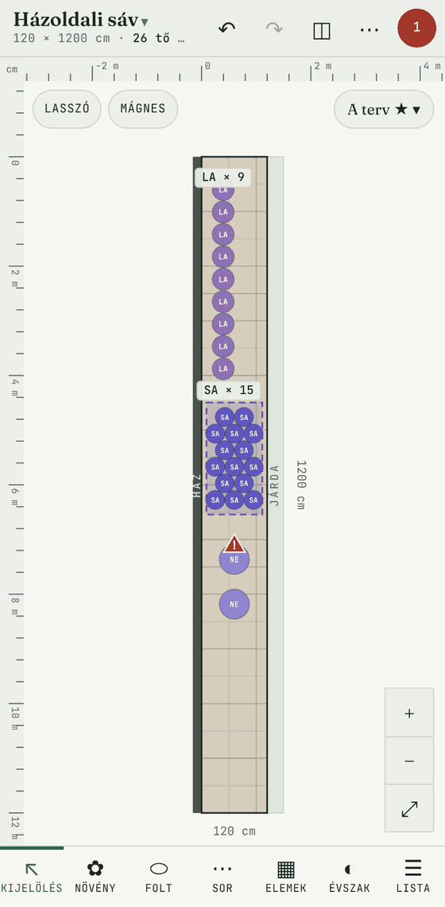

**Felső sáv**

- **A terület neve ▾**: itt váltasz a területek között, és itt hozol létre újat. Alatta látszik a terület mérete, a tövek száma, az égtáj és a napsütés.
- **↶ / ↷**: visszavonás és újra (100 lépésig). Számítógépen **Ctrl+Z** és **Ctrl+Y** is működik.
- **◫ Nézet**: rétegek, növényméret (kifejlett vagy ültetéskori), fotók, mágnes; innen nyílik a növényadatbázis, a rögzített elemek, az ötletgenerátor, valamint a menetrend és gondozás.
- **⋯ Projekt**: mentés, betöltés, megosztás, képek, látványterv, nyomtatás.
- **Kerek szám**: a figyelmeztetések száma. Zöld, ha nincs gond, piros, ha hiba van.

**A rajz**

- **Nagyítás**: két ujjal széthúzva vagy összecsípve; számítógépen egérgörgővel vagy a jobb alsó **+ / −** gombokkal.
- **Mozgatás**: egy ujjal húzva az üres részen, illetve két ujjal.
- **Illesztés**: dupla koppintás vagy a **⤢** gomb, ez a teljes területet mutatja.
- **Vonalzó**: a szélén méterben.
- **Változatgomb**: jobb felül (pl. „A terv ★ ▾”), ez nyitja a változatokat.

**Alsó eszköztár**

| Eszköz | Mire való |
|---|---|
| **Kijelölés** | elemek kijelölése, mozgatása, szerkesztése |
| **Növény** | egyedi tövek elhelyezése |
| **Folt** | egy terület kitöltése egy fajjal |
| **Sor** | egyenes sor vagy ív mentén ültetés |
| **Elemek** | gyep, burkolat, fal, kerítés, csap, fa stb. rajzolása |
| **Évszak** | a kert színei hónapról hónapra |
| **Lista** | növénylista, rendelés, költség, menetrend |

 

## 3. Területek

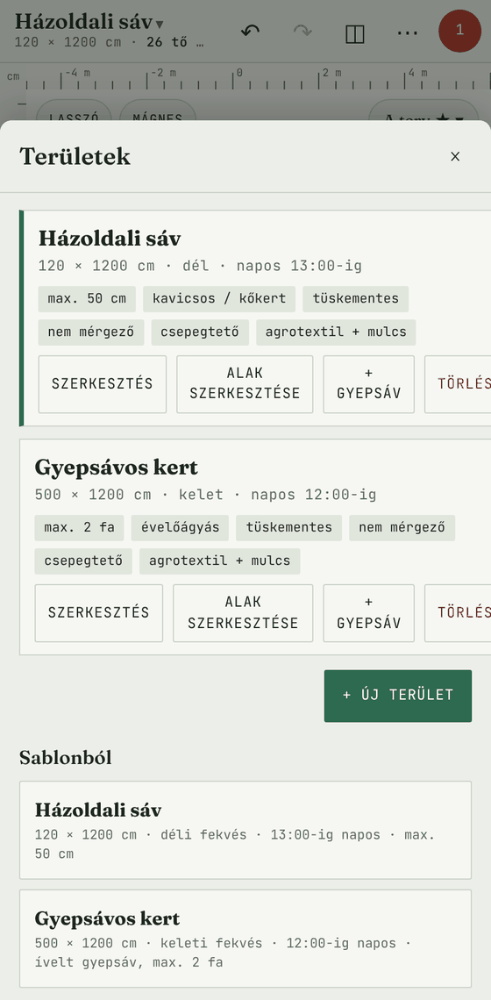

Egy projektben több terület is lehet (pl. előkert, oldalkert, hátsó kert). A **terület nevére** koppintva megnyílik a lista:

- **A terület nevére koppintva** erre a területre váltasz.
- **Szerkesztés**: név, méret, égtáj, napsütés, talaj és korlátok.
- **Alak szerkesztése**: a terület sarkait húzhatod a rajzon.
- **+ Gyepsáv**: gyepsáv rajzolása erre a területre (lásd [4. fejezet](#4-rögzített-elemek-gyep-burkolat-fal-fa)).
- **Törlés**: visszavonással visszahozható.
- **+ Új terület** vagy **Sablonból**: új terület hozzáadása.

**Új terület adatai**

- **Név**
- **Alak**:
  - **téglalap**: megadod a szélességet és a hosszt cm-ben;
  - **szabad alak**: a terven rajzolod meg. Koppints a sarkokra egymás után, majd koppints újra az első pontra, vagy nyomd meg a **Kész** gombot. Rajzolás közben az oldalak hossza cm-ben látszik, a **Vissza** az utolsó pontot veszi el.
- **Égtáj és napsütés**: a napsütést szövegesen adod meg, pl. „13:00-ig”, „délig”, „egész nap”. Ebből számolja a program, hogy a hely napos, félárnyékos vagy árnyékos; a *Napfény a szabályokhoz* mezőben felülírhatod.
- **Területtípus**: évelőágyás, kavicsos/kőkert, árnyékkert, szegély, edényes. A mulcsajánlást és az ötletgenerátort befolyásolja.
- **Talaj**: homokos, vályog, agyagos, meszes, savanyú, tápanyagszegény. Ha megadod, a program jelzi, ha egy növény más talajt kedvel.
- **Korlátok**:
  - legnagyobb megengedett magasság;
  - *Tüskementes legyen*;
  - *Nem mérgező legyen* (gyerek, háziállat miatt);
  - fák legnagyobb száma;
  - fajonkénti darabkorlát (pl. „LA: 12”);
  - csepegtető öntözés és ágyásfedés (ezek a gondozási tanácsokat befolyásolják).

**Kész alak módosítása**: *Alak szerkesztése*. Húzd a sarkokat. Az oldalak közepén lévő pöttyel új sarkot szúrsz be, a kijelölt sarkot a **Sarok törlése** gomb veszi el.

 

## 4. Rögzített elemek: gyep, burkolat, fal, fa…

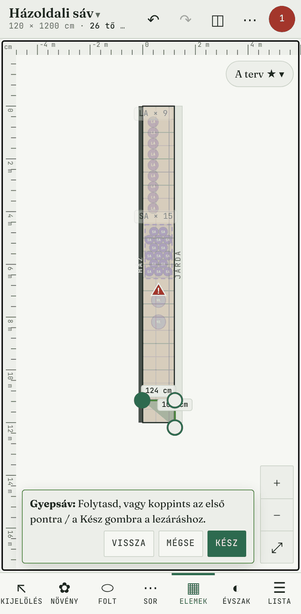

A rögzített elemek nem növények, de a terv része: a szabályok és az ötletgenerátor figyelembe veszi őket. Az alsó eszköztár **Elemek** gombjával egy sor nyílik a rajz alatt.

| Elem | Hogyan rajzolod |
|---|---|
| **Gyepsáv** | Koppints a sarkaira, majd *Kész*. Ide nem kerül növény: ha mégis oda tennél, figyelmeztet. |
| **Burkolat** | Húzd végig a téglalapot; egy koppintás 1 × 1 m-es elemet tesz le. |
| **Fal, Kerítés** | Húzd végig a vonalat; a hosszabb irányba áll be. |
| **Ablak, Csap, Akna, Fa, Diófa, Egyéb** | Koppints a rajzra, ahová kerüljön. |

**Lerakás után**

- Az új elem kijelölve marad. Húzással mozgathatod, a **Tulajdonságok** gombbal pontos helyet és méretet adhatsz neki.
- A gyep alakja később is módosítható: *Lista → gyepsáv → Alak szerkesztése a rajzon*.
- A **Lista** gomb az összes elemet felsorolja; a gyepnél a területét is m²-ben, ami a fűmag vagy a gyepszőnyeg mennyiségéhez jól jön.

**Diófa és juglone-zóna**

A diófa gyökere juglont termel, ami sok növénynek árt. A *Rögzített elemek* listájában állítható a zóna sugara (alapból 15 m). A zónán belül a program jelzi azokat a fajokat, amelyek juglone-tűrése nem dokumentált vagy érzékeny.

**Háttérkép**

A *Rögzített elemek* listájában **Háttérképet** (fotót vagy tervrajzot) is tehetsz a rajz alá. A méretarányt két ismert pont megjelölésével állítod be. Az átlátszóság állítható, és a *Nézet → Rétegek* alatt ki is kapcsolható.

 

## 5. Növények elhelyezése

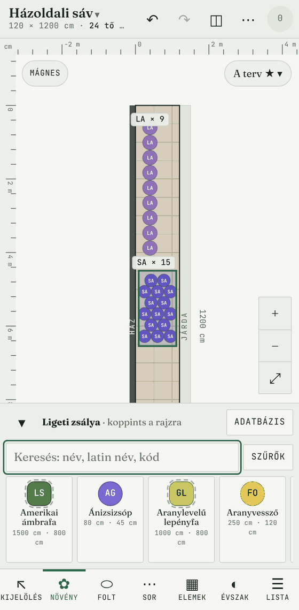

A **Növény**, **Folt** és **Sor** eszköznél alul megjelenik a **növénypaletta**:

- **Keresés** név, latin név vagy kód szerint (pl. „levendula”, „Salvia”, „LA”);
- a **Szűrők** gombbal szűrhetsz mérgezőségre, magasságra, terjedelemre, fényre, talajra (lásd [9. fejezet](#9-növényadatbázis-és-szűrők));
- egérrel rámutatva, telefonon nyomva tartva megjelenik a növény **infókártyája**;
- a **▾** gombbal a paletta becsukható.

Minden növénynek két betűs **kódja** és saját színe van (pl. LA = levendula). A rajzon és a listákban ezzel azonosítod.

**Egyedi tő** (*Növény* eszköz): koppints egy növényre a palettán, majd a rajzra. Úgy is leteheted, hogy a palettáról felhúzod a rajzra.

**Folt** (*Folt* eszköz): válassz növényt, majd húzd körbe ujjal a területet. A program a tőtávval kitölti a foltot, és kiírja a darabszámot. Fent választhatsz **eltolt rács** (természetesebb) és **négyzetes** kiosztás között.

**Sor** (*Sor* eszköz):

- **Egyenes**: húzz egy vonalat, vagy koppints a két végére.
- **Ív**: húzd végig az ujjad a kívánt vonalon.

A tövek egyenletes tőtávval kerülnek a vonalra, a darabszám automatikus.

**Mágnes**: a 10 cm-es rácsra igazít. A gombja fent van, és a *Nézet* menüben is kapcsolható.

 

## 6. Kijelölés, szerkesztés, csere

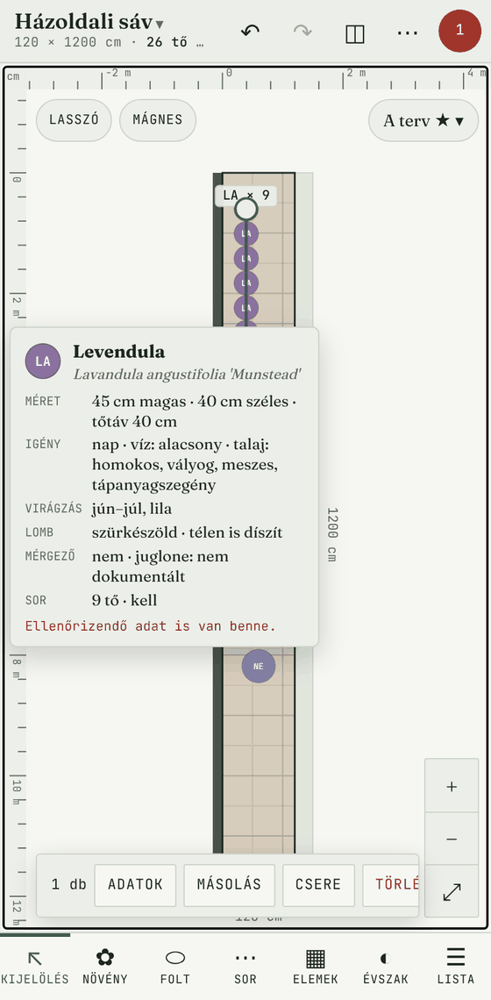

**Kijelölés** eszközzel:

- **Koppintás** egy növényre vagy foltra: kijelöli.
- **Shift/Ctrl + kattintás**: több elem kijelölése számítógépen.
- **Lasszó**: kapcsold be, és húzd körbe a kijelölendő elemeket.
- **Húzás**: a kijelölt elemek mozgatása.
- **Folt vagy sor sarkai**: egy kijelölt folt vagy sor sarkpontjait húzva alakítod; a darabszám közben frissül.

A kijelölés alatt megjelenő sáv gombjai:

- **Adatok**: faj, állapot (*kell, megrendelve, megvan, beültetve*), megjegyzés. Foltnál és sornál a **tőtáv** és a kívánt **darabszám** is itt állítható; a darabszámból a program kiszámolja a tőtávot.
- **Másolás**: a kijelölt elemek másolata kissé eltolva.
- **Csere**: az összes ilyen faj cseréje egy másikra (lásd lent).
- **Törlés**
- **×**: kijelölés megszüntetése.

### Növény cseréje mindenhol

Ha egy faj nem tetszik (pl. a sövénynek választott növény), egy lépésben lecserélheted egy másikra. Elérhető a kijelölés sáv **Csere** gombjával, az *Adatok* lapról, vagy a változatoknál a **⇄ Növény cseréje** gombbal.

1. **Ezt cserélem**: a lecserélendő faj (a kijelöltből indítva előre ki van választva).
2. **Erre cserélem**:
   - elöl a **hasonló típusú** fajok állnak (sövény helyett sövény, cserje helyett cserje), azon belül a hasonló magasságúak;
   - ha egy faj nem illik a területhez, a ⚠ jel mutatja, miért.
3. **Hol cseréljem**: csak a szerkesztett változatban, a terület összes változatában, vagy az egész projektben.
4. **Tőtáv**: alapból a foltok és sorok az új növény tőtávját kapják, és a darabszám újraszámolódik.
5. Az előnézet megmutatja, mi lesz belőle; a **Csere** gomb elvégzi. Visszavonással visszaállítható.

 

## 7. Növényinformáció és fotó

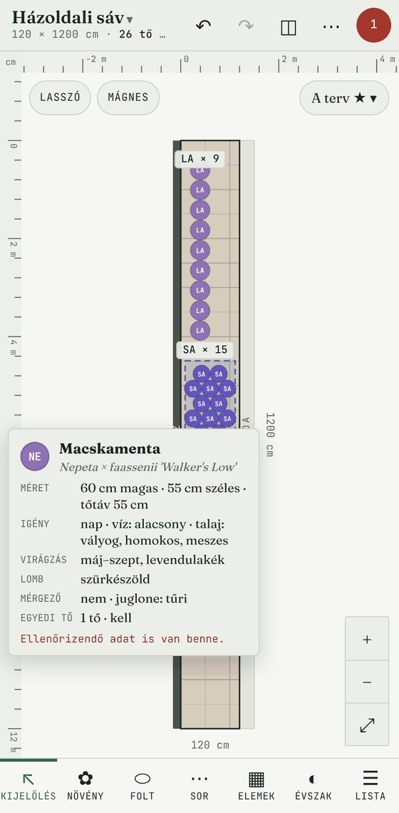

Vidd az egeret egy növény fölé a rajzon vagy a palettán, telefonon tartsd rajta az ujjad fél másodpercig. Megjelenik az **infókártya**:

- fotó;
- magyar és latin név;
- magasság, szélesség, tőtáv;
- nap-, víz- és talajigény;
- virágzási idő és szín, lombszín, téli díszítőérték;
- mérgezőség, tüske, juglone-tűrés;
- a rajzon azt is, hány tő van abban a foltban vagy sorban, és milyen állapotú.

**A fotók**

- **Forrás**: a program a latin név alapján a Wikipédiáról/Wikimedia Commonsból tölti le őket. A kép alatt ott a szerző és a licenc.
- **Offline**: első betöltés után a fotó a készüléken tárolódik, utána internet nélkül is megjelenik.
- **Fajta helyett faj**: a Wikipédián többnyire a fajról van kép, nem a konkrét fajtáról.
- **Saját fotó**: ha más képet szeretnél, a növény adatlapján feltölthetsz sajátot, vagy megadhatsz egy képlinket.
- **Kikapcsolás**: *Nézet → Növényfotók a Wikipédiáról*.

**„Ellenőrizendő” adat**

Ha a kártyán ez a felirat látszik, a növény valamelyik adata (pl. mérgezőség, juglone-tűrés, ár) bizonytalan forrásból származik. Vásárlás előtt érdemes utánanézni.

 

## 8. Figyelmeztetések

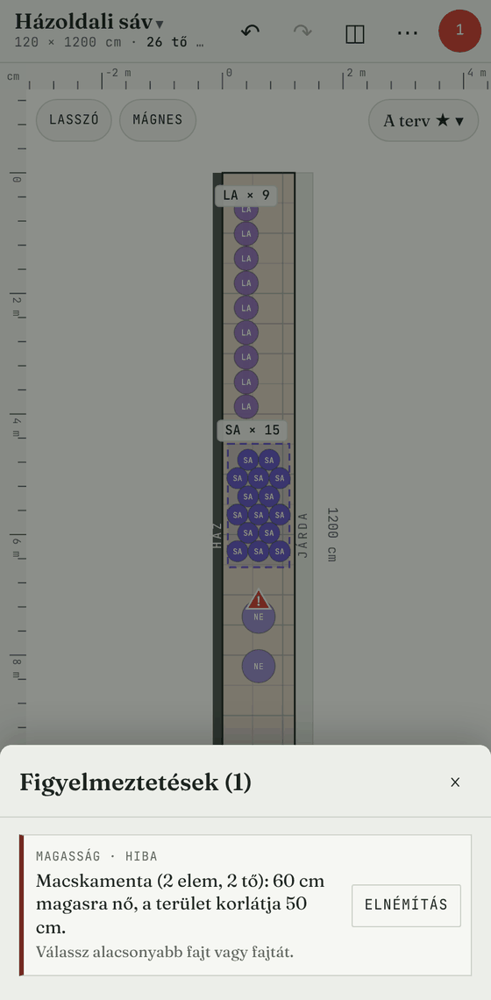

A program folyamatosan ellenőrzi a tervet, és a rajzon ⚠ jellel mutatja a gondot. Ezeket figyeli:

- **magasság**: a növény magasabb, mint a terület korlátja;
- **tüske, mérgező**: ha a terület tüskementes vagy nem mérgező növényt kér;
- **juglone**: érzékeny vagy nem dokumentált faj a diófa zónájában;
- **tőtáv**: túl sűrű folt vagy sor, illetve egymásba érő tövek;
- **határon kívül**: a növény a területen kívül van;
- **gyep**: növény a gyepsávon;
- **csap, akna, burkolat**: a növény elfedi; **ablak**: magas növény az ablak előtt;
- **fajkorlát, fák száma**;
- **nap-, víz- és talajigény**: nem illik a helyhez, vagy eltérő vízigényű növények kerültek egymás mellé.

A felső sáv kerek számára koppintva nyílik a **lista**. Egy figyelmeztetésre koppintva a rajz odaugrik, és kijelöli a növényt. Ha valami szándékos kivétel, az **Elnémítás** gombbal kikapcsolhatod; az elnémítottak a lista alján továbbra is megnézhetők.

 

## 9. Növényadatbázis és szűrők

Az adatbázisban 146 faj van: évelők, díszfüvek, talajtakarók, cserjék, sövénynövények, terülő örökzöldek és fák. Megnyitása: *Nézet → Növényadatbázis*, vagy a palettán az **Adatbázis** gomb.

- **Szerkesztés**: egy növényre koppintva minden adata módosítható: név, kód, méret, tőtáv, igények, virágzás, színek, ár, kiszerelés, fotó, megjegyzés. Az „ellenőrizendő ✓” címkére koppintva jelölöd, hogy utánanéztél.
- **+ Új növény**: saját növény felvétele; a kódot a név alapján javasolja.
- **Import és export**: JSON és CSV. A CSV Excelben, Google Táblázatban szerkeszthető, és visszatölthető.

**Szűrők** (a palettán és az adatbázisban közösek):

- **mérgező**: nem mérgező / mérgező / nem ismert;
- **magasság** és **terjedelem**: cm-től cm-ig;
- **fény**: napos, félárnyékos, árnyékos;
- **talaj**;
- **tüske**, **juglone-tűrés**, **virágszín**.

## 10. Változatok

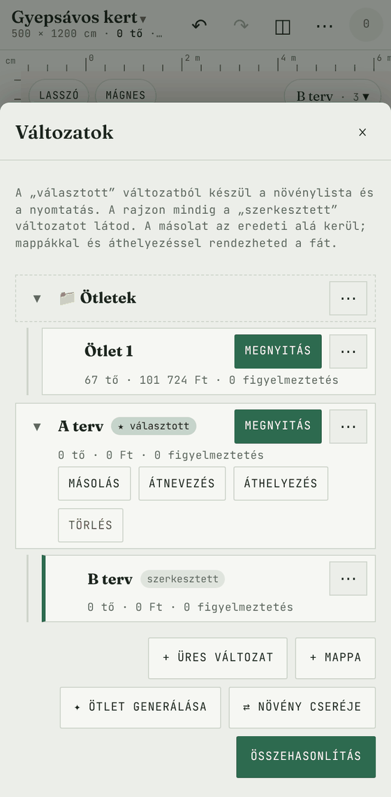

Egy területre több tervet is készíthetsz (A terv, B terv, ötletek), és összehasonlíthatod őket. A rajz jobb felső sarkában a **változatgomb** nyitja meg a változatok **fáját**.

**Két fontos fogalom**

- **szerkesztett** változat: ezt látod és módosítod a rajzon;
- **★ választott** változat: ebből készül a növénylista, a menetrend és a nyomtatás.

**A fa kezelése**

- **Megnyitás**: az adott változatot szerkeszted.
- **⋯** a sor végén: *Legyen a választott*, *Másolás*, *Átnevezés*, *Áthelyezés*, *Törlés*.
- **Másolás**: a másolat az eredeti alá kerül.
- **+ Mappa**: a változatok csoportosítása. Az **Áthelyezés** bármely mappa vagy változat alá, illetve a legfelső szintre visz.
- **▾ / ▸**: ágak összecsukása; csukva kiírja, hány változat van benne.
- Mappa vagy változat törlésekor az alatta lévők egy szinttel feljebb kerülnek.
- **Összehasonlítás**: két változat egymás mellett, a tőszám, a költség és a figyelmeztetések különbségével.

 

## 11. Ötletgenerátor

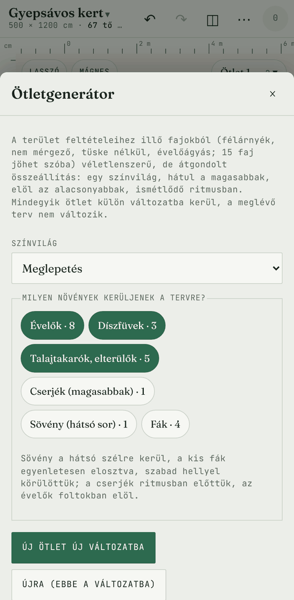

Ha nem tudod, hol kezdd, kérj ötletet. Megnyitása: változatok → **✦ Ötlet generálása**, vagy *Nézet → Ötletgenerátor*.

1. **Színvilág**: *Meglepetés*, vagy lila–ezüst, meleg sárga–bordó, fehér–kék–zöld, rózsaszín–lila.
2. **Milyen növények kerüljenek a tervre**:

   | Típus | Hová kerül |
   |---|---|
   | Évelők, Díszfüvek, Talajtakarók | ismétlődő foltokban, elöl az alacsonyabbak |
   | Cserjék | egyesével, ritmusban |
   | Sövény | egy sorban a hátsó szélen (a fal vagy kerítés felől) |
   | Fák | egyenletesen elosztva, szabad hellyel körülöttük |

   A típusok mellett a szám mutatja, hány faj jöhet szóba ezen a területen. Amelyikből egy sincs, az nem választható (pl. egy 50 cm-es magassági korlátú sávban a sövény).
3. **Ötlet generálása**: az összeállítás egy új változatba kerül (*Ötletek* mappa), a meglévő terv nem változik.
4. **Újra**: ugyanabba a változatba sorsol újat. **Új ötlet új változatba**: újabbat készít a régi mellé.

**Mire figyel a generátor**

- csak a terület fényéhez, korlátaihoz és talajához illő fajokat használ;
- kerüli a gyepet és a burkolatot;
- a diófa zónájában juglone-tűrő fajt választ;
- vigyáz, hogy a virágzás tavasztól őszig tartson, és télen is legyen díszítő elem.

Az eredményt a szabálymotor rögtön ellenőrzi. Ezután a változatot ugyanúgy szerkesztheted, mint bármelyik másikat.

 

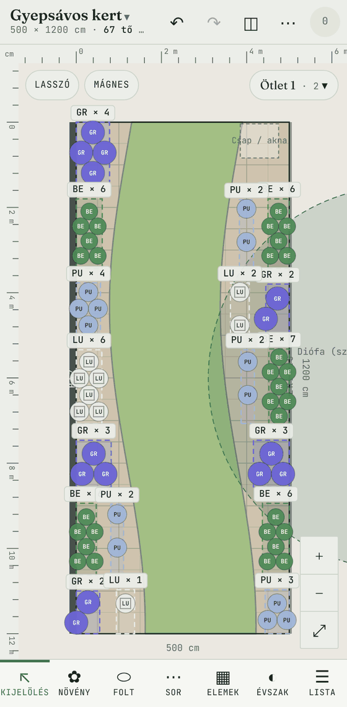

## 12. Évszaknézet

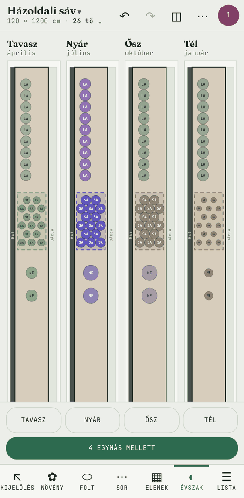

Az **Évszak** eszközzel a rajz a növények valódi színeit mutatja:

- **Tavasz, Nyár, Ősz, Tél** gomb vagy havi csúszka: látszik, mi virágzik, milyen a lomb, mi marad meg télen;
- **4 egymás mellett**: a négy évszak egyszerre, összehasonlításhoz.

Évszaknézetből készített kép (PNG/SVG) az adott hónap színeivel készül.

 

## 13. Növénylista, rendelés, költség

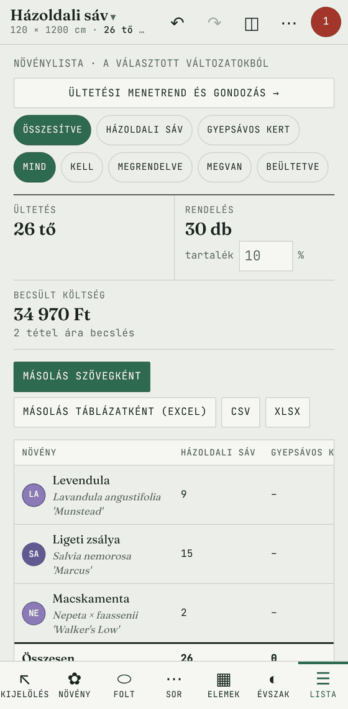

A **Lista** eszköz összesíti a **választott** változatok növényeit:

- **Ültetés**: hány tő kerül a földbe.
- **Rendelés**: hány darabot rendelj, **tartalékkal**. A tartalék %-a állítható; a fák nem kapnak tartalékot.
- **Becsült költség**: a „becsl.” jelölésű árak becslések, a „bolt” jelölésűek valós ajánlatból származnak.
- **Szűrés**: *Összesítve* vagy területenként; állapot szerint (*kell, megrendelve, megvan, beültetve*).
- **Állapot**: a táblázatban fajonként egyszerre állítható.
- **Másolás szövegként**: üzenetbe, e-mailbe.
- **Másolás táblázatként (Excel)**: beillesztve helyes oszlopokat ad.
- **CSV, XLSX**: fájl letöltése; **Megosztás**: telefonon a megosztó menüvel.

 

## 14. Ültetési menetrend és gondozás

A *Lista* tetején az **Ültetési menetrend és gondozás →** gomb nyitja meg (vagy *Nézet → Menetrend és gondozás*).

- **Menetrend**: add meg az ültetés kezdetét és végét. A program napokra bontja a munkát a terület mérete alapján:
  - talaj-előkészítés;
  - csepegtető és agrotextil, ha a területnél bejelölted;
  - előbb a fák, aztán az évelők fajonként;
  - mulcsozás, beöntözés;
  - tartaléknap esőre vagy késő szállításra.

  A feladatok kipipálhatók, a **Menetrend másolása szövegként** gomb megosztásra kész szöveget ad.
- **Gondozási naptár** Győr éghajlatára: hónapról hónapra a tervben szereplő fajok teendői (pl. levendula visszavágása, díszfüvek kifésülése, fiatal fák öntözése aszályban).
- **Mulcsajánlás**: szárazságtűrő növények köré világos, 4–8 mm-es kavics, máshová fakéreg, a javasolt vastagsággal.

## 15. Mentés, megosztás, nyomtatás, képek

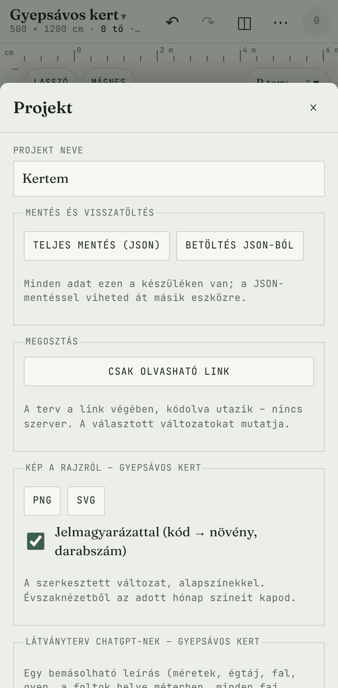

**Automatikus mentés**: a munka minden módosítás után a készüléken mentődik, nincs „Mentés” gomb.

A felső sáv **⋯** gombja nyitja a **Projekt** menüt:

- **Projekt neve**
- **Teljes mentés (JSON)**: a teljes projekt egy fájlban. Ezzel viheted át másik eszközre, és ez a biztonsági mentés is. **Betöltés JSON-ból**: visszatölti (a mostani terv helyére kerül).
- **Csak olvasható link**: a terv a link végében, kódolva utazik, szerver nélkül. Aki megnyitja, látja a rajzot és a listát, de nem tudja módosítani.
- **Kép a rajzról**: **PNG** vagy **SVG**, kérésre **jelmagyarázattal** (kód → növény neve, latin neve, darabszám).
- **Látványterv ChatGPT-nek**: lásd a következő fejezetet.
- **Nyomtatás / mentés PDF-be**: A4, álló vagy fekvő tájolásban. Területenként egy oldal: felülnézet, négy évszak, növénylista, figyelmeztetések, a végén összesítés. PDF-be a böngésző nyomtatási ablakában menthetsz („Mentés PDF-ként”).
- **Bevezető újra**

 

## 16. Látványterv ChatGPT-vel

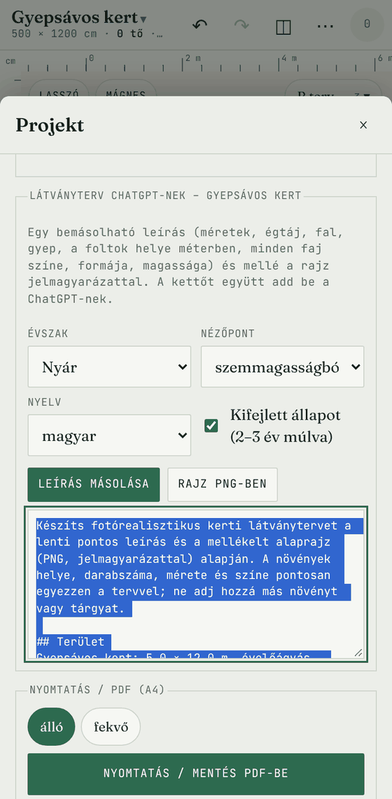

A program elkészít egy részletes leírást, amiből egy képgeneráló mesterséges intelligencia (pl. ChatGPT) valósághű látványtervet tud rajzolni.

1. **⋯ → Látványterv ChatGPT-nek.**
2. Állítsd be:
   - az **évszakot**;
   - a **nézőpontot** (szemmagasságból, madártávlatból, mindkettő);
   - a **nyelvet** (magyar vagy angol);
   - hogy kifejlett, 2–3 éves vagy frissen ültetett állapotot mutasson.
3. **Leírás másolása**: vágólapra teszi a szöveget. Benne vannak a méretek, az égtáj, a fal, járda és gyep, minden folt helye méterben, és minden faj színe, formája, magassága az adott évszakban.
4. **Rajz PNG-ben**: letölti a felülnézetet jelmagyarázattal.
5. A ChatGPT-ben illeszd be a szöveget, és **csatold mellé a PNG-t**.

A leírás arra kéri az MI-t, hogy ne tegyen a képre más növényt vagy tárgyat. Az eredmény mégis csak illusztráció; a pontos tervet a rajz és a lista adja.

 

## 17. Telepítés a telefonra, offline használat

Az alkalmazás telepíthető a kezdőképernyőre, mint egy mobilalkalmazás:

- **Android (Chrome)**: ⋮ menü → *Telepítés* vagy *Hozzáadás a kezdőképernyőhöz*.
- **iPhone (Safari)**: Megosztás gomb → *Főképernyőhöz adás*.
- **Számítógép (Chrome, Edge)**: a címsor végén a telepítés ikon.

Első megnyitás után **internet nélkül is működik**, és a munka a készüléken mentődik. Internet csak a fotók első letöltéséhez kell.

**Fontos:** az adatok a böngészőben tárolódnak. Ha törlöd a böngésző adatait, vagy másik készülékre váltasz, a terv nem jön magától. Ezért időnként készíts **Teljes mentést (JSON)**.

## 18. Tippek és gyakori kérdések

**Melyik eszközzel ültessek gyorsan sok tövet?**
Foltokkal és sorokkal: egy mozdulat, és a darabszám automatikus. Egyedi tövet csak szoliternek, fának vagy hangsúlynak érdemes letenni.

**Hogyan tervezzek egy egészen új kertet?**
1. Hozz létre egy területet (téglalap vagy rajzolt alak), és add meg az égtájat, a napsütést, a talajt és a korlátokat.
2. Az **Elemek** eszközzel rajzold be a gyepet, a burkolatot, a falat, a kerítést és a meglévő fákat.
3. Kérj egy-két ötletet az **ötletgenerátorral**, vagy ültess kézzel.
4. A figyelmeztetéseket javítsd vagy némítsd el.
5. A legjobb változatot jelöld **★ választottnak**.
6. Nézd meg a **Lista** és a **Menetrend** oldalt, és készíts PDF-et.

**Nem tetszik egy faj, de már sok helyen szerepel. Mit tegyek?**
Használd a **Csere** funkciót ([6. fejezet](#növény-cseréje-mindenhol)); az összes tövét egy lépésben lecseréli.

**Miért jelez egy növényt, ha az szerintem jó oda?**
A szabályok a megadott korlátokból és a növény adataiból dolgoznak. Ha a növény adata pontatlan, javítsd az adatbázisban; ha szándékos kivétel, használd az **Elnémítás** gombot.

**Elrontottam valamit.**
**↶ Visszavonás**, akár 100 lépésig. A törölt terület, változat és csere is visszahozható.

**Hogyan nézhet bele valaki más?**
**⋯ → Csak olvasható link**. Ha szerkeszteni is szeretné, küldd el a **Teljes mentés (JSON)** fájlt; a *Betöltés JSON-ból* gombbal nyithatja meg.

**Pontosak a növényadatok?**
A kezdőlista kertészeti alapadatokból készült. A bizonytalan adatok (különösen a mérgezőség, a juglone-tűrés és a becsült ár) **ellenőrizendőként** vannak jelölve; vásárlás előtt nézz utána, és javítsd az adatbázisban.
